# 🦄 Ellie's Games

**26 touch-friendly little games, made for Ellie and Grandpa to play together on a phone.**

Memory matching, tic-tac-toe, finger painting, Plinko, washing a muddy puppy, and more, each with big buttons, bright colors and plenty of confetti.

### ▶️ [Play now → dougdarst.github.io/KidGames](https://dougdarst.github.io/KidGames/)

[](https://github.com/DougDarst/KidGames/actions/workflows/test.yml)

<p align="center">
  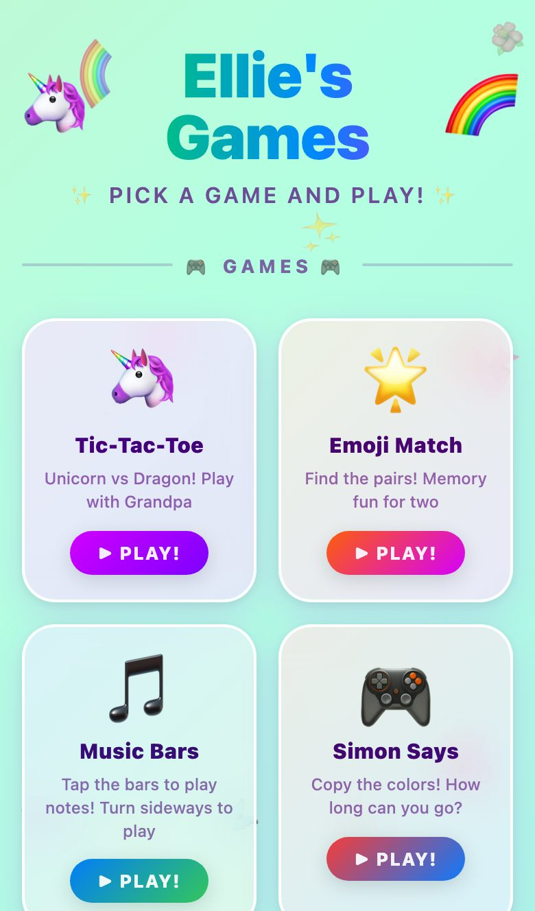
</p>

## 📸 A peek inside

<table>
  <tr>
    <td align="center">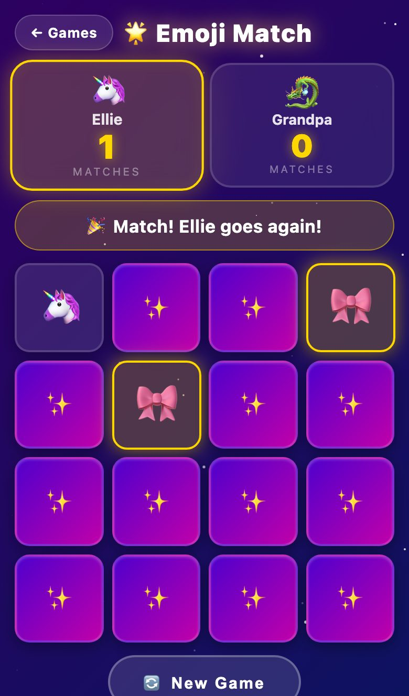<br><b>Emoji Match</b><br><sub>2-player memory game</sub></td>
    <td align="center">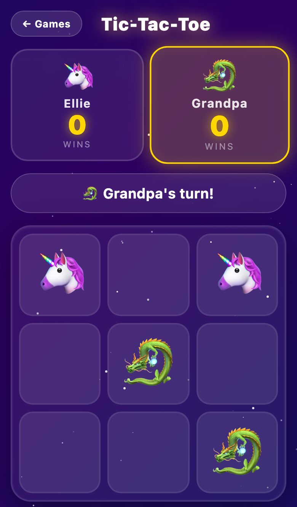<br><b>Tic-Tac-Toe</b><br><sub>Unicorn vs Dragon</sub></td>
    <td align="center">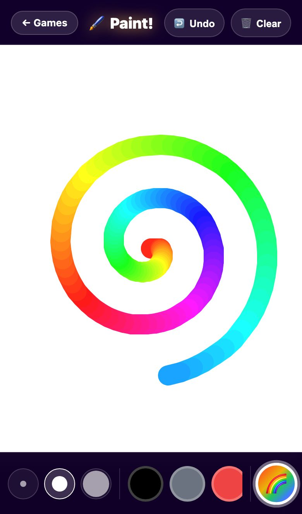<br><b>Paint!</b><br><sub>finger painting, rainbow brush</sub></td>
    <td align="center">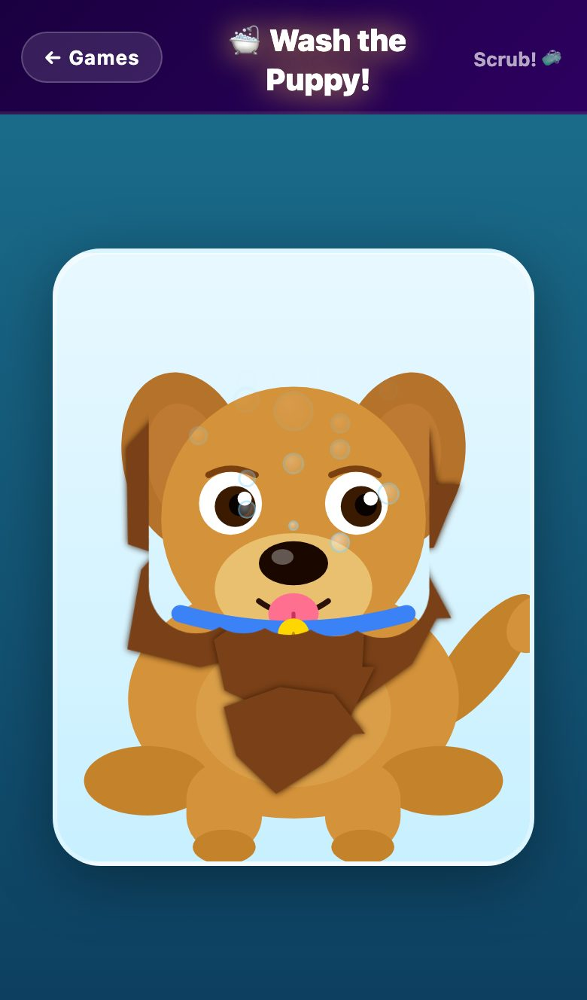<br><b>Wash the Puppy!</b><br><sub>scrub the mud off</sub></td>
  </tr>
  <tr>
    <td align="center">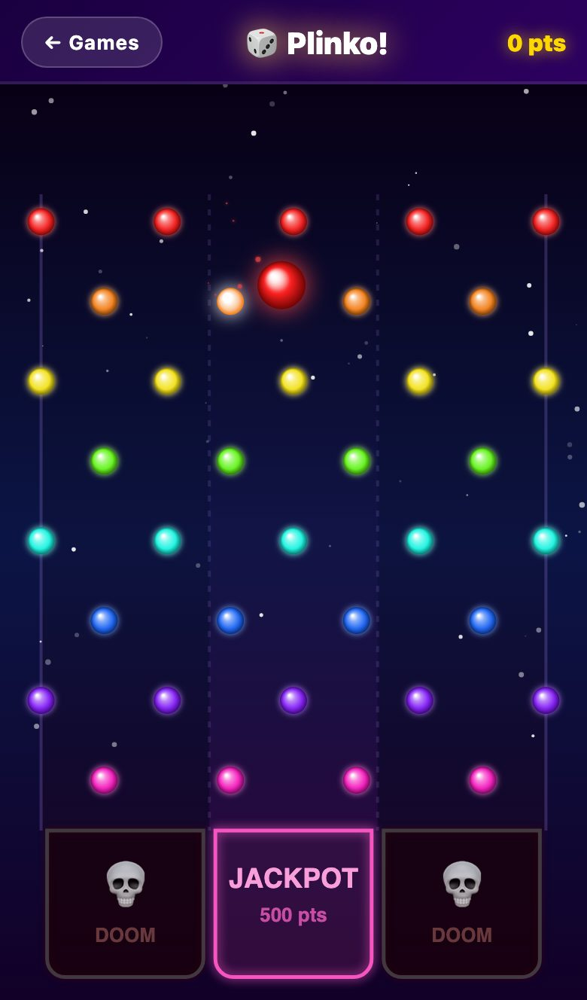<br><b>Plinko!</b><br><sub>drop a marble for the jackpot</sub></td>
    <td align="center">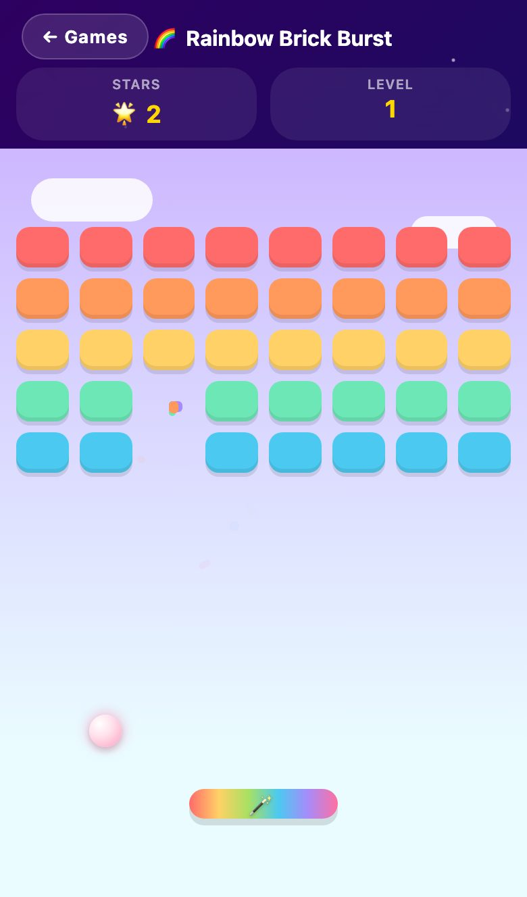<br><b>Rainbow Brick Burst</b><br><sub>bounce the sparkle ball</sub></td>
    <td align="center">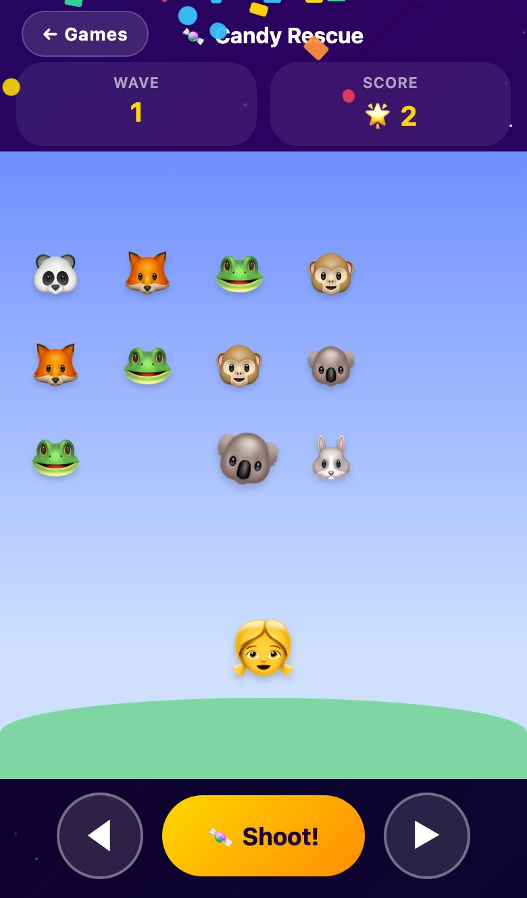<br><b>Candy Rescue</b><br><sub>shoot candy, rescue animals</sub></td>
    <td align="center">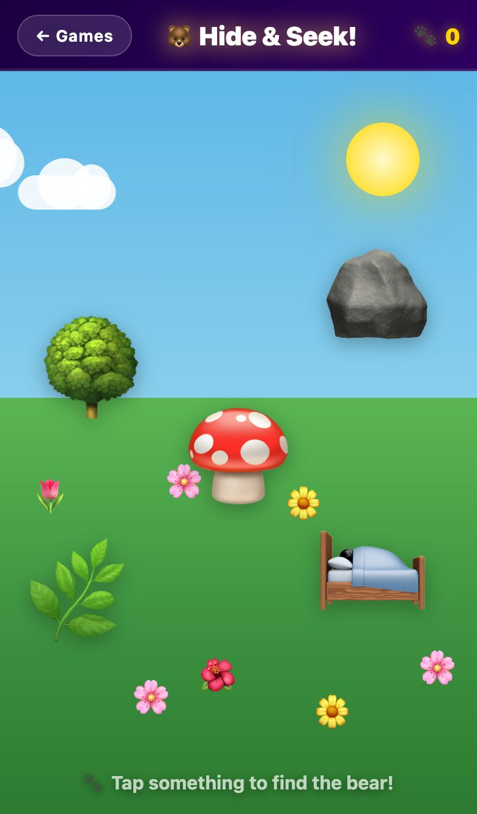<br><b>Hide &amp; Seek!</b><br><sub>find where the bear is hiding</sub></td>
  </tr>
  <tr>
    <td align="center">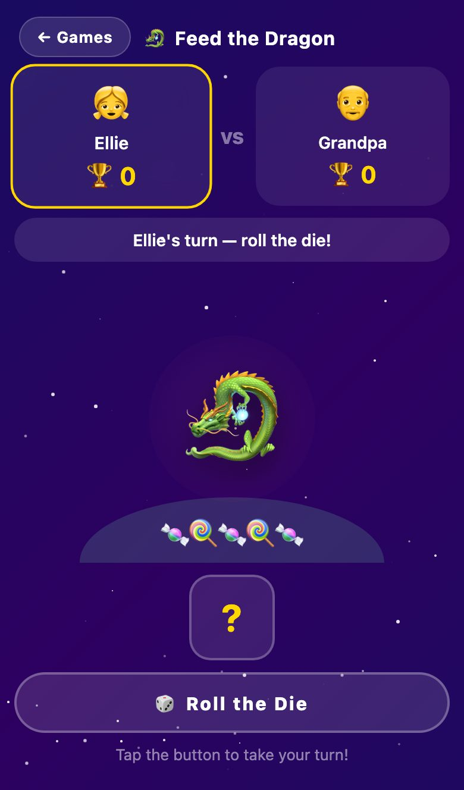<br><b>Feed the Dragon!</b><br><sub>roll, feed… don't make him sneeze</sub></td>
    <td align="center">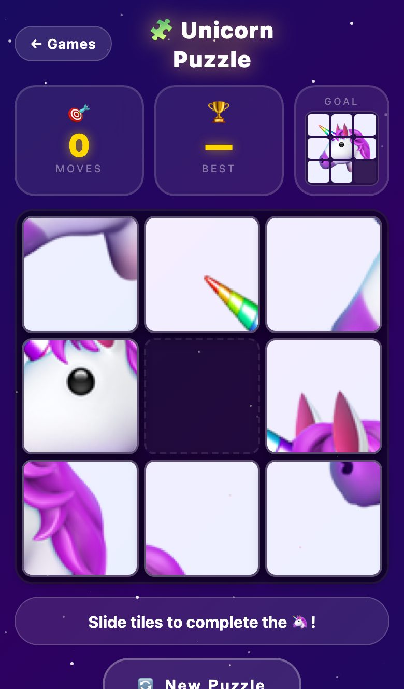<br><b>Unicorn Puzzle</b><br><sub>3×3 sliding tiles</sub></td>
    <td align="center">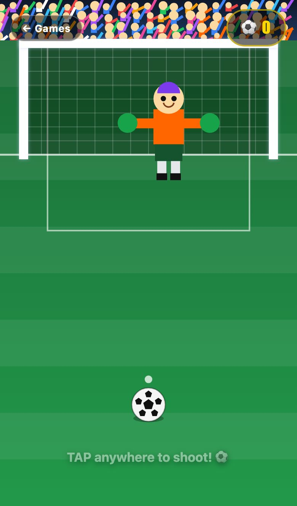<br><b>Tap to Shoot!</b><br><sub>beat the goalie</sub></td>
    <td align="center">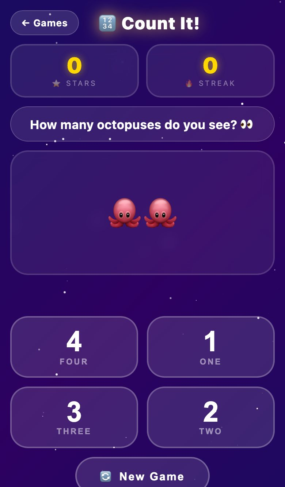<br><b>Count It!</b><br><sub>count the emojis, 1–10</sub></td>
  </tr>
</table>

## 🎮 All the games

| | Game | What you do |
|---|---|---|
| 🦄 | **Tic-Tac-Toe** | Unicorn vs Dragon, two players |
| 🌟 | **Emoji Match** | Flip cards to find pairs, two players take turns |
| 🎵 | **Music Bars** | Tap colored bars to play notes (turn the phone sideways) |
| 🎮 | **Simon Says** | Copy the color sequence, which gets longer each round |
| 🎈 | **Pop the Balloons** | Pop balloons, avoid the black ones |
| 🔢 | **Count It!** | Count the emojis and pick the number |
| 🧩 | **Unicorn Puzzle** | Slide the tiles back into a unicorn picture |
| 🔤 | **First Letter** | What letter does the emoji start with? |
| ✏️ | **Dot Art** | Connect the dots to draw a picture |
| 🏓 | **Pong!** | Two players, one at each end of the screen |
| ➕ | **Add It Up!** | Addition with sums up to 10 |
| 🔨 | **Whack-a-Mole** | Tap moles before they hide, 60 seconds |
| 🎣 | **Fishing!** | Drag the hook to catch fish, 60 seconds |
| 🔷 | **Shape Sorter** | Drag shapes into matching outlines, for toddlers |
| 🐶 | **Emoji Fun** | Drag a finger and animal emojis follow, for toddlers |
| 🎨 | **Sticker Scene** | Decorate a beach, space, meadow or forest |
| 🌈 | **Color Match!** | Tap the circle that matches the shape's color |
| 🖌️ | **Paint!** | Finger painting with 18 colors, a rainbow brush and undo |
| ⚽ | **Tap to Shoot!** | Kick at the goal and celebrate a GOAL! |
| 🐻 | **Hide & Seek!** | Find the bear; wrong spots hide funny animals |
| 🎰 | **Plinko!** | Drop a marble through rainbow pegs |
| 🛁 | **Wash the Puppy!** | Scrub the muddy puppy clean |
| 🐉 | **Feed the Dragon!** | Two-player dice game, feed him 20 candies and… ACHOO! |
| 🏹 | **Rainbow Archery!** | Pull back and hit the moving target |
| 🍬 | **Candy Rescue!** | Shoot candy to rescue the animals, wave after wave |
| 🌈 | **Rainbow Brick Burst!** | Bounce the ball and pop every brick |

## 🛠️ How it's made

No frameworks, no build step, and no app store. Each game is a single HTML page, and GitHub Pages serves this repo exactly as it is. Every push to `main` goes live.

- **One page per game** (`matching.html`, `paint.html`, …), each with its own styles and script inline.
- **A small shared kit.** [`shared/kit.css`](shared/kit.css) holds the common look: starry background, buttons, game-over card and confetti. [`shared/kit.js`](shared/kit.js) adds zoom blocking on iOS and the `Kit.confetti`, `Kit.shuffle`, `Kit.audio` and `Kit.tone` helpers.
- **Built for touch.** No pinch-zoom, big tap targets, and sound that works on iPhone.

### Run it locally

Open `index.html` in a browser, or serve the folder:

```sh
python3 -m http.server   # then visit http://localhost:8000
```

### Tests

[Playwright](https://playwright.dev) tests run on an iPhone-sized **WebKit** browser (the engine Chrome uses on iPhone) and on Chromium, locally and on every push.

```sh
npm install
npx playwright install chromium webkit
npm test
```

They check that every game loads and can be tapped without errors, that the game rules work (tic-tac-toe wins, solvable puzzles, valid answer choices), that the shared kit works, and that the project conventions are followed.

### Handy scripts

| Command | What it does |
|---|---|
| `npm test` | Run all tests |
| `npm run bump-kit` | After editing `shared/`, bump the `?v=` cache-buster on every page |
| `npm run screenshots` | Retake the screenshots in this README |

### Adding a game

See [CLAUDE.md](CLAUDE.md) for the step-by-step guide and UI patterns. In short: start from `matching.html`, use the shared kit, add a card to `index.html`, and run `npm test`.
